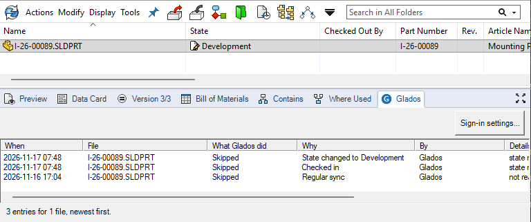

# GLADOS PDM Add-in

A SOLIDWORKS PDM Professional vault add-in for [GLADOS](https://github.com/deloarts). It tells
GLADOS right away when a vault file changes, so item data doesn't have to wait for the next
poll, and adds a GLADOS tab to the File Explorer vault view that shows what GLADOS did with the
selected files.



## Features

- Notifies GLADOS when a file changes state, is checked in, deleted, moved or renamed.
- Shows the GLADOS sync history of the selected files on the GLADOS tab: when, what GLADOS did
  and why.
- Retries notifications in the background when GLADOS is unreachable or busy.
- **GLADOS: Resync** in the right-click menu sends the notification again for the selected files.
- Each Windows user signs in with their own GLADOS personal access token.

The add-in only sends "look at this file" notifications and reads the sync history. It never
writes item data to GLADOS, never changes vault data and never blocks a vault operation. GLADOS
reads the files itself through the PDM Web API. See [docs/DESIGN.md](docs/DESIGN.md) for the
details.

## Requirements

- SOLIDWORKS PDM Professional 2025 on every client (earlier versions are untested)
- .NET Framework 4.8, 64-bit clients
- GLADOS 0.1.x with SolidWorks PDM switched on

## Installation

1. Download `GladosPdmAddin.dll` and `SHA256SUMS.txt` from [Releases](../../releases) and check
   the hash with `Get-FileHash -Algorithm SHA256 GladosPdmAddin.dll`.
2. In the PDM Administration tool, go to **Add-ins > New Add-in** and upload the DLL.
3. Clients get the add-in on their next vault login. Nothing has to be installed on each client.

The same DLL works with any GLADOS server. There is no auto-update: every new version has to be
uploaded again.

## Sign-in

1. In GLADOS, go to **Account > Personal Access Tokens > Create PDM Add-in Token** and copy the
   token. The button only shows while SolidWorks PDM is switched on, and your role needs the
   `use:pdm_addin` permission.
2. In File Explorer, open the vault, select the **GLADOS** tab in the bottom panel and click
   **Sign in...**.
3. Enter the server URL and the token and click **Save and test**.

The sign-in is per Windows user and applies to File Explorer, SOLIDWORKS and the Administration
tool at once. The token is stored in the Windows Credential Manager. When it expires, create a
new one and save it the same way.

The log is at `%LOCALAPPDATA%\Glados\pdm-addin.log`. Attach it to a bug report.

## Building

Use the full Visual Studio MSBuild. `dotnet build` can't build the legacy project.

```powershell
MSBuild.exe GladosPdmAddin.csproj /p:Configuration=Debug /t:Rebuild /nr:false
```

To test a build without uploading it, register `bin\Debug\GladosPdmAddin.dll` under
**Add-ins > Debug Add-ins** in the Administration tool and log in to the vault again.

## Documentation

- [docs/DESIGN.md](docs/DESIGN.md): hooks, sign-in, version check, releases, log, retries and
  rate limit
- [docs/RELEASE.md](docs/RELEASE.md): versioning and release flow
- [CHANGELOG.md](CHANGELOG.md)
- [SECURITY.md](SECURITY.md)

## License

glados-pdm-addin is source-available under the [DELOARTS License (DAL) 1.0.0](LICENSE.md). You may use, change and share it for noncommercial purposes: personal use, research and study, and use by charitable, educational, public research and government organizations. Any commercial use, including using it in a business's vault, needs a separate commercial license from license@deloarts.com.

Third-party components bundled with glados-pdm-addin remain under their own licenses.
